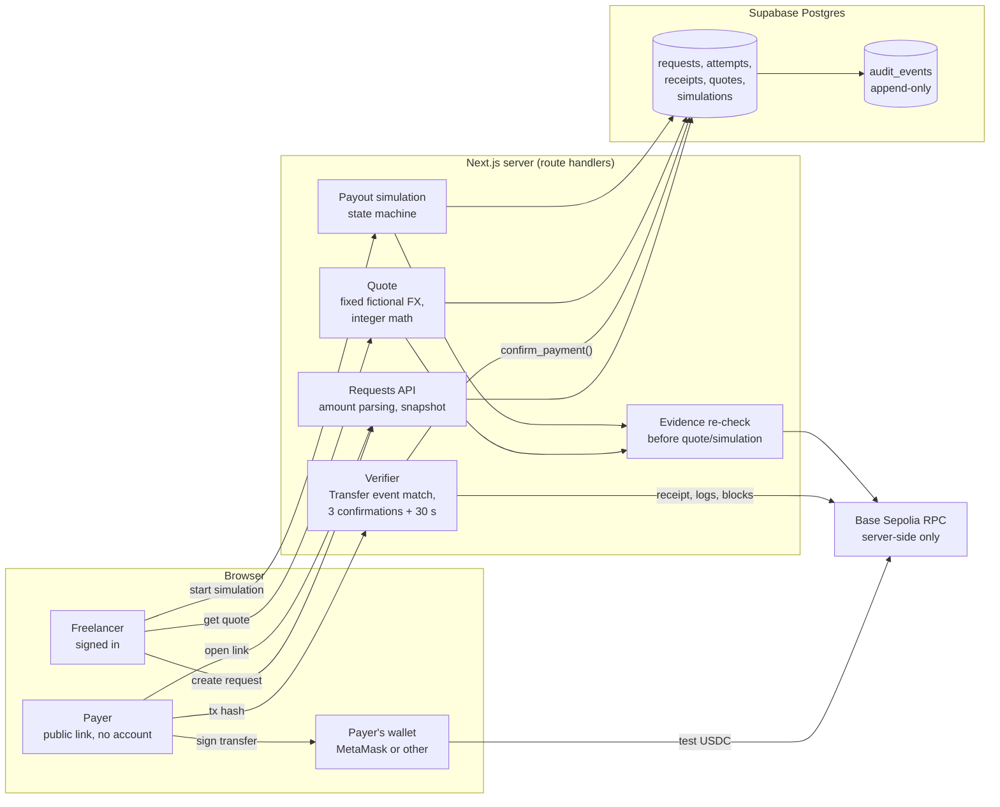

# Architecture

What the prototype runs today, and where a real product would need controls that this MVP deliberately does not build. Boxes marked **not built** are product placeholders, not code.

## Built: request → verified receipt → simulated payout

Trust boundaries:

- **Browser → server.** The browser never decides that a payment happened. A submitted transaction hash is only a pointer; the server reads the chain itself.
- **Server → chain.** One trusted RPC endpoint, set server-side. Chain ID, token address and decimals are code constants (D4), so no setting can point the app at mainnet.
- **Server → database.** Writes go through `service_role`-only Postgres functions that lock rows and re-check state. Owners can only read their own rows (RLS). Payers have no database access; the public page gets a minimal projection.
- **Simulation.** No tokens move, nothing is reserved and no bank details exist anywhere in the schema. `simulation boolean check (simulation)` makes a non-simulated payout row impossible to insert.

## Where a real product would add controls (not built)

The Airtm framing asked where KYC/AML, FX pricing, confirmation, monitoring and reconciliation occur. In a production rail they sit roughly here:

| Control | Prototype | What production would need |
| --- | --- | --- |
| KYC / KYB | None. Email sign-in only. | Identity verification for the freelancer (and possibly the payer), done by or with a licensed partner. See [compliance-research.md](compliance-research.md). |
| Sanctions / wallet screening | None. | Screen payer and recipient addresses and people before accepting funds; decide what happens to funds that arrive from a flagged address. |
| Confirmation | 3 blocks and ≥ 30 s chain time (D38). | A finality policy based on the L2's `safe`/`finalized` heads and the off-ramp's own deposit rules. |
| Transaction monitoring | None. | Rules and case management for unusual patterns; travel-rule data exchange with other providers where required. |
| FX pricing | Fixed fictional rate and fees (`illustrative-2026-10.1`). | Live rate from a licensed FX provider, quote lock with expiry (this part is built), disclosure of spread and taxes. |
| Off-ramp | Simulated state machine. | Licensed partner, payout to a verified local account, failure and return handling. |
| Reconciliation | Every state change writes an append-only audit event; evidence is re-checked before payout. | Three-way match of chain transfers, internal ledger and bank statements, with breaks investigated. |
| Reporting | None. | Whatever the operating model triggers (e.g., Receita Federal DeCripto, BCB FX reporting); see the register. |

## Code map

| Concern | Where |
| --- | --- |
| Chain allowlist (Base Sepolia, test USDC) | `src/lib/chain/allowlist.ts` |
| Transfer verification (D37 event match, D38 age) | `src/lib/chain/verify-transfer.ts` |
| Evidence re-check before payout (rule 9) | `src/lib/chain/recheck-evidence.ts`, `src/lib/payouts/server.ts` |
| Quote arithmetic | `src/lib/quotes/fx.ts` (mirrored by CHECK constraints in the migration) |
| Database functions, RLS, triggers | `supabase/migrations/` |
| Testnet / simulation disclosure | `src/components/TestnetBanner.tsx`, labels in `src/lib/payouts/views.ts` |
